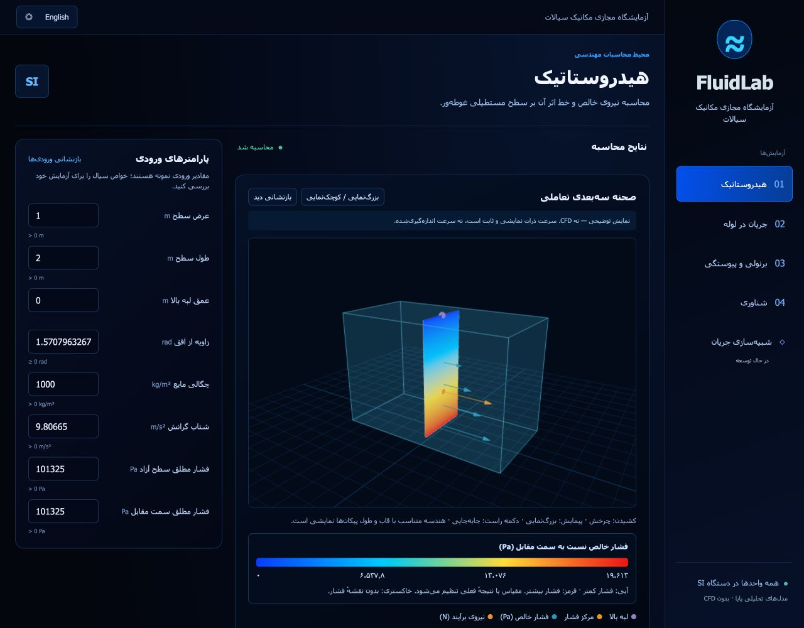

# FluidLab | آزمایشگاه مجازی مکانیک سیالات

پروژهٔ آموزشی **محمدعلی شمشیری — سیالات ۱**

FluidLab کمک می‌کند با تغییر ورودی‌هایی مثل عمق، چگالی، قطر لوله و دبی، اثر آن‌ها را روی نتیجهٔ محاسبات، نمودارها و مدل سه‌بعدی ببینید. رابط برنامه فارسی و انگلیسی است.



## چه کارهایی انجام می‌دهد؟

- **هیدروستاتیک:** فشار، نیروی وارد بر صفحهٔ مستطیلی، گشتاور و محل اثر برآیند.
- **برنولی و پیوستگی:** سرعت و فشار بین دو مقطع؛ حالت ایده‌آل و حالت دارای افت انرژی.
- **جریان در لوله:** عدد رینولدز، ضریب اصطکاک دارسی و افت فشار.
- **شناوری:** حجم جابه‌جایی و آبخور جسم منشوری قائم.

رنگ آبی تا قرمز روی سطوح، افزایش فشار را نشان می‌دهد. راهنمای رنگ مقدار و مرجع فشار را مشخص می‌کند. نمایش سه‌بعدی آموزشی است و **CFD نیست**. بخش جداگانهٔ Flow Simulation هنوز در حال توسعه است.

## اجرای سریع

به Python 3.10 یا بالاتر و Node.js 22.12 یا بالاتر نیاز دارید.

در پوشهٔ پروژه، ترمینال اول:

```sh
python3 -m venv .venv
source .venv/bin/activate
python -m pip install -r requirements-api.txt
python -m uvicorn api.main:app --host 127.0.0.1 --port 8000
```

در ویندوز، به‌جای دستور فعال‌سازی بالا از `.venv\Scripts\activate` استفاده کنید.

ترمینال دوم:

```sh
cd web
corepack pnpm install --frozen-lockfile
corepack pnpm dev
```

سپس http://127.0.0.1:5173 را در همان کامپیوتر باز کنید. انتشار کد در GitHub به‌تنهایی برنامه را آنلاین نمی‌کند.

اگر پورت 8000 اشغال است، سرور را با `--port 8001` اجرا کنید و در مک/لینوکس برای رابط بنویسید:

```sh
FLUIDLAB_API_URL=http://127.0.0.1:8001 corepack pnpm dev
```

## ساختار ساده

| پوشه | کاربرد |
|---|---|
| `fluidlab_physics/` | محاسبات مستقل Python با واحدهای SI |
| `api/` | ارتباط رابط با موتور محاسبات از طریق FastAPI |
| `web/` | رابط React، TypeScript، Three.js و Plotly |
| `tests/` | آزمون‌های محاسبات و API |

## آزمون و محدودیت

آخرین اجرای آزمون‌های ویژگی رنگ فشار: **۶۴ آزمون Python و ۲۱ آزمون رابط موفق**؛ بررسی TypeScript و ساخت برنامه نیز موفق بود. این نتیجه به معنی اعتبارسنجی همهٔ کاربردهای مهندسی نیست.

فرض‌ها و واحدها کنار نتایج نمایش داده می‌شوند. محاسبات برای مدل‌های آموزشی تعریف‌شده‌اند؛ سطوح خمیده، جریان گذرا و CFD پشتیبانی نمی‌شوند. گزارش خروجی قابل دانلود هنوز پیاده‌سازی نشده است.

- [راهنمای سادهٔ فارسی](README-FA.md)
- [راهنمای کامل اجرا و آزمون](RUNNING.md)
- [معادلات و محدودیت‌های موتور](ENGINE.md)
- [محاسبات مرجع](REFERENCES.md)

## English

A bilingual educational fluid mechanics laboratory with independent Python calculations, a FastAPI backend, a React interface, interactive Three.js scenes and Plotly charts. Includes hydrostatics, Bernoulli/continuity, pipe losses and buoyancy. All inputs use SI units. Visualizations illustrate analytical models; they are not CFD. See [RUNNING.md](RUNNING.md) for setup.
